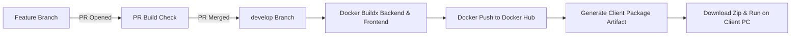

# Nizam Bags POS - DevOps Architecture & Deployment Guide

This document outlines the DevOps architecture, the GitHub Actions CI/CD pipeline, Docker image publishing, client update automation, and database persistence guarantees for **Nizam Bags POS**.

---

## 1. Architectural Evolution: Old vs. New

### The Old Approach (Manual Zip Transfer)
* Every code change required zipping the entire repository (frontend, backend, node_modules, source code, scripts).
* Large file size transferred via pen drive / cloud to the client Windows 10 machine.
* Source code was exposed directly on the client machine.
* Running `docker compose up -d --build` on the client machine forced slow local builds, consuming heavy CPU, RAM, and disk space.

### The New Approach (Automated CI/CD & Image Registry)
* Developer creates a feature branch (`feature/*`), implements changes, tests locally, and opens a Pull Request to `develop`.
* When the PR is merged into `develop`, GitHub Actions CI/CD triggers automatically.
* GitHub Actions builds the frontend and backend Docker images and pushes them directly to Docker Hub:
  * `valkisolutions/nizam-frontend:<tag>` and `:latest`
  * `valkisolutions/nizam-backend:<tag>` and `:latest`
* GitHub Actions generates a lightweight client deployment bundle (`nizam-pos-client-deploy-<sha>.zip`, size < 100 KB).
* On the client machine: simply run `update-nizam-pos.bat`.
  * Pulls the new Docker Hub images.
  * Stops & removes old frontend and backend containers.
  * **Preserves MySQL container and `db_data` volume completely untouched** (all existing sales records remain safe).
  * Automatically verifies and configures Windows Startup (`shell:startup`) so POS starts whenever Windows turns ON.
  * Opens Google Chrome in POS application mode (`http://localhost`).

---

## 2. GitHub Secrets Configuration

Before running the workflow, configure the following secrets in your GitHub repository:

### Where to add secrets:
1. Go to your GitHub repository: `https://github.com/<owner>/nizam-bags-works`
2. Click **Settings** (top navigation).
3. In the left sidebar, click **Secrets and variables** -> **Actions**.
4. Click the green button: **New repository secret**.

### Secrets to add:
| Secret Name | Description | Example Value |
|-------------|-------------|---------------|
| `DOCKERHUB_USERNAME` | Your Docker Hub account username or organization | `valkisolutions` |
| `DOCKERHUB_TOKEN` | Docker Hub Personal Access Token (PAT) with `Read & Write` permissions | `dckr_pat_xxxxxxxxxxxxxxxxxxxx` |

> [!TIP]
> **How to generate Docker Hub PAT:**
> 1. Log in to [Docker Hub](https://hub.docker.com/).
> 2. Click your username in top-right -> **Account Settings**.
> 3. Navigate to **Security** -> **New Access Token**.
> 4. Give description: `GitHub Actions CI-CD`, Access permissions: `Read, Write, List`, then click **Generate**.
> 5. Copy the generated token and save it as `DOCKERHUB_TOKEN` in GitHub.

---

## 3. GitHub Actions CI/CD Workflow (`.github/workflows/deploy.yml`)

The workflow triggers on:
1. **Push / Merge to `develop`**: When any PR is merged into `develop`, full CI/CD runs (builds images, pushes to Docker Hub, and packages the client update artifact).
2. **Pull Request to `develop`**: Validates the build by running Docker build tests without pushing to Docker Hub.
3. **Workflow Dispatch (Manual)**: You can also manually trigger the pipeline anytime with an optional custom tag from the **Actions** tab.

### Workflow Stages:


### Artifact Generation:
At the end of every successful workflow run on `develop`:
* An artifact named `nizam-pos-client-deploy-<short-sha>` is uploaded.
* You can download it directly from the GitHub Actions run summary page.
* It contains only the production compose configuration and the update scripts (no source code!).

---

## 4. Client Machine Deployment & Update (Windows 10)

### One-Click Update Process:
1. Download the artifact `nizam-pos-client-deploy-<sha>.zip` from GitHub Actions (or copy `update-nizam-pos.bat` and `docker-compose.prod.yml`).
2. Extract the files on the client machine (e.g. into the existing folder or `C:\nizam-pos`).
3. Double-click `update-nizam-pos.bat` (or Right-Click -> **Run as administrator**).

### What `update-nizam-pos.bat` does under the hood:
1. **Checks Docker Engine**: Waits for Docker Desktop daemon. If not running, attempts to launch Docker Desktop and waits until ready.
2. **Pulls Updated Images**:
   ```cmd
   docker pull valkisolutions/nizam-backend:latest
   docker pull valkisolutions/nizam-frontend:latest
   ```
3. **Safely Stops & Removes Only Old Frontend and Backend Containers**:
   ```cmd
   docker compose -f docker-compose.prod.yml stop backend frontend
   docker compose -f docker-compose.prod.yml rm -f backend frontend
   ```
4. **Starts Updated POS Stack**:
   ```cmd
   docker compose -f docker-compose.prod.yml up -d
   ```
5. **Configures Windows Boot Autostart**:
   Creates/updates `Nizam Bags POS.lnk` inside the Windows Startup folder (`shell:startup`) pointing to `scripts\start-nizam-pos-windows.bat`.
6. **Cleans Up Old Images**:
   Runs `docker image prune -f` so disk space is never wasted.
7. **Launches Chrome**:
   Waits for `http://localhost` to answer HTTP 200, then automatically opens Chrome in application mode (`chrome.exe --app=http://localhost`).

---

## 5. MySQL Data Persistence Guarantee (Sales & Inventory Records)

### Why is MySQL data 100% safe during updates?
1. **Docker Named Volume**:
   The MySQL container uses:
   ```yaml
   volumes:
     - db_data:/var/lib/mysql
   ```
   Docker stores this volume separately on the host disk (managed by Docker Engine).
2. **Deterministic Project Name**:
   `docker-compose.prod.yml` explicitly defines `name: nizam-bags-works`. This guarantees Docker will always attach to the exact same named volume `nizam-bags-works_db_data`.
3. **Targeted Container Recreation**:
   The update script specifically stops and removes only `backend` and `frontend`. The `mysql-db` container is never removed, and under NO circumstances is `docker compose down -v` executed.
4. **Non-Destructive Database Schema**:
   `backend/server.js` uses `CREATE TABLE IF NOT EXISTS`. When the new backend container boots up and connects to MySQL, it reuses existing tables without overwriting or deleting any existing rows.

---

## 6. Automatic Startup on Windows Login

When the client powers ON their Windows 10 computer:
1. Docker Desktop launches automatically (configured via Docker Desktop Settings -> General -> "Start Docker Desktop when you sign in to Windows").
2. Windows Startup runs `scripts/start-nizam-pos-windows.bat` from `shell:startup`.
3. `start-nizam-pos-windows.ps1`:
   - Waits for Docker Engine daemon to respond (up to 2 minutes).
   - Starts containers with `docker compose -f docker-compose.prod.yml up -d`.
   - Waits for `http://localhost` to be responsive.
   - Automatically opens Google Chrome with the POS interface.
